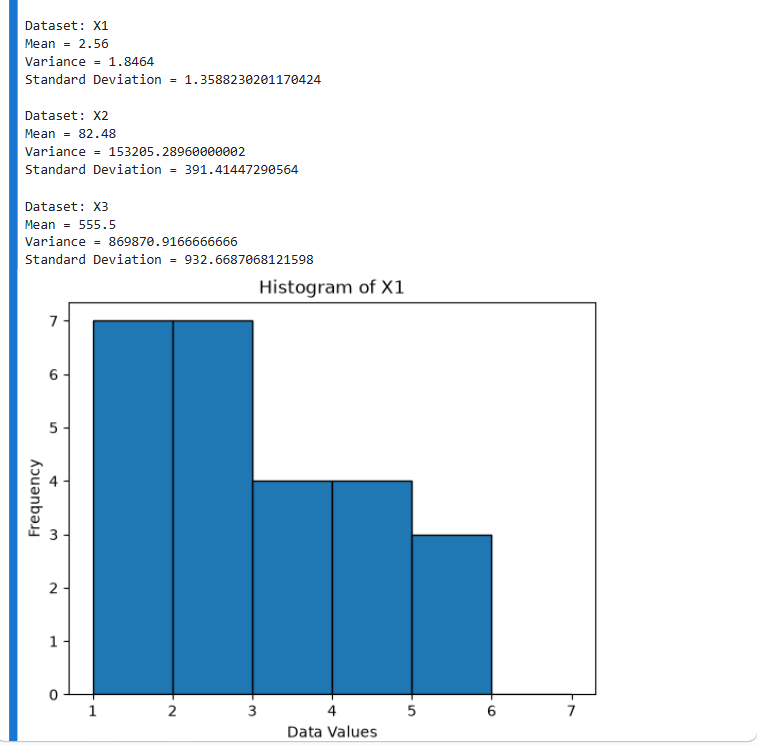

# Experiment 2: Normal (Gaussian) Distribution Analysis

## Overview
Computes probability density values and statistical parameters (mean, standard deviation) for normal distribution, plotting normal distribution curves and histogram distributions.

- **Libraries Used**: `numpy, matplotlib, math`
- **Key Concepts**: `Normal Distribution, Gaussian PDF, Variance, Data Distribution`

---

## Files in this Branch
- `practical2.py`: Standalone executable Python program
- `practical2.ipynb`: Jupyter Notebook implementation
- `output.png`: Execution output / plot screenshot

---

## How to Run

```bash
python practical2.py
```

---

## Execution Output


